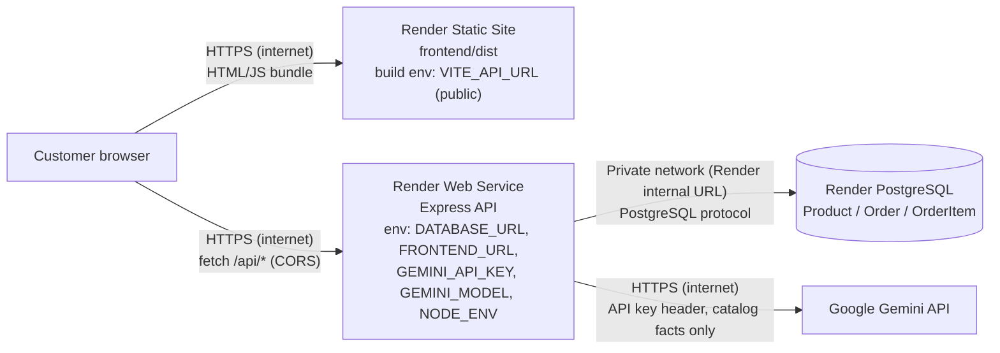

# ShopSmart Deployment Plan

Status: **plan only**. No hosting has been approved for this class, so the release is a **local release candidate**. The platform below was chosen because every part has a free tier. Check the platform's current free-tier terms and commands before using it.

| Service | Platform (free tier) | Example URL |
| --- | --- | --- |
| React/Vite frontend | Render **Static Site** | `https://shopsmart-web.onrender.com` |
| Express API | Render **Web Service** (Node) | `https://shopsmart-api.onrender.com` |
| PostgreSQL | Render **PostgreSQL** (free DB expires after about 30 days, which is enough for the lab) | internal host only |
| AI provider | Google Gemini API (already integrated) | `generativelanguage.googleapis.com` |

Alternative if the database must outlive 30 days: Neon free PostgreSQL. Only `DATABASE_URL` changes; add `?sslmode=require`.

## Diagram



```text
                       internet (HTTPS)                          internet (HTTPS)
 [Browser] ──────────────────────────────▶ [Static Site: frontend/dist]
     │                                        config: VITE_API_URL (public, baked in at build)
     │ internet (HTTPS, CORS)
     └──────────────────────────────────────▶ [Web Service: Express API] ──────────────▶ [Gemini API]
                                                config: DATABASE_URL, FRONTEND_URL,      key stays on server
                                                GEMINI_API_KEY, GEMINI_MODEL, NODE_ENV
                                                       │ private (Render internal network)
                                                       ▼
                                               [PostgreSQL: shopsmart]
```

The browser never talks to PostgreSQL or Gemini directly. Only the API holds secrets.

## Configuration by service

| Service | Variable | Value | Secret? | Where it is set |
| --- | --- | --- | --- | --- |
| Static Site | `VITE_API_URL` | `https://shopsmart-api.onrender.com/api` | **No**: copied into the public JS bundle | Render → Static Site → Environment (used at build time) |
| Web Service | `DATABASE_URL` | Render Postgres **Internal** Database URL | **Yes** | Render → Web Service → Environment |
| Web Service | `FRONTEND_URL` | `https://shopsmart-web.onrender.com` (exact origin, no trailing slash) | No | same |
| Web Service | `GEMINI_API_KEY` | team's key | **Yes** | same (never in `frontend/.env`, never committed) |
| Web Service | `GEMINI_MODEL` | `gemini-3.8-flash` | No | same |
| Web Service | `NODE_ENV` | `production` | No | same |
| Web Service | `PORT` | set by Render automatically | No | `server.js` already reads `process.env.PORT` |

## Answers to the plan questions

1. **Where are the Vite build files hosted, and which API URL does the frontend use?** On a Render Static Site. Build command `npm ci && npm run build`, publish directory `frontend/dist`. Add a rewrite rule `/*` → `/index.html` so React Router deep links such as `/cart` load. The frontend calls `VITE_API_URL=https://shopsmart-api.onrender.com/api`.
2. **Where does Express run, and what public URL serves `/api/health`?** On a Render Web Service with the repository root as its root directory. Build command `npm ci --include=dev && npm run db:generate && npm run db:deploy`; start command `npm run start --workspace backend`. `--include=dev` is needed because the Prisma CLI is a devDependency and `NODE_ENV=production` would otherwise skip it. Health: `https://shopsmart-api.onrender.com/api/health`.
3. **Where does PostgreSQL run, and how does the server get `DATABASE_URL` securely?** On Render PostgreSQL in the same region as the API. The Internal Database URL is pasted into the Web Service's Environment settings, which are encrypted and not visible in the repo or logs. It is never written to a committed file. The local password `shopsmart_dev` in `.env.example`/README is a classroom-only default and is **not** used for staging; Render generates its own password.
4. **Which origin do `FRONTEND_URL` and CORS permit?** Exactly `https://shopsmart-web.onrender.com`. `app.js` passes `FRONTEND_URL` to `cors({ origin })`, so other sites' browsers are refused.
5. **Where is the provider key stored, and how is it kept out of the bundle and the repo?** It lives only in the Web Service environment as `GEMINI_API_KEY`, read in `backend/src/services/aiProvider.js`. It has no `VITE_` prefix, so Vite cannot bundle it; `.env` is in `.gitignore`. Verification: after each build, `grep -rE "AIza|GEMINI|DATABASE_URL" frontend/dist` must return nothing. Only public product fields and a contact-redacted question are sent to Gemini.
6. **How are migrations applied without wiping orders?** `npm run db:deploy` (= `prisma migrate deploy`) runs in the API build command. It applies only committed migrations from `backend/prisma/migrations` and never resets data. `npm run db:migrate` (`migrate dev`) is never run against staging. **Seeding:** `npm run db:seed` deletes all orders and products, so it is run **once only, on the new empty database**, from a team laptop using the External Database URL in a temporary shell variable, and never again.
7. **Who can access staging, and is only fictional data used?** The free Render tiers have no login wall, so access control is by obscurity only. Mitigations: the URLs are shared only with the instructor and team (not posted publicly); the footer already says "Simulated purchases only"; only fictional names and `@example.com` emails are entered; there is no real payment; the services are deleted after grading. Because authentication is absent, **staging must not be advertised or used to collect real personal data**.

## Proxy setting (done)

Render sits behind a proxy. `backend/src/app.js` sets `app.set('trust proxy', 1)` when Render's `RENDER` variable is present, so express-rate-limit keys on each visitor's address instead of giving everyone one shared 20-questions-per-minute limit. Covered by `backend/test/rateLimitProxy.test.js`.

## Deployment order

1. Create the PostgreSQL database and copy its Internal and External URLs.
2. Create the Web Service with the build/start commands and environment above. The first build runs `migrate deploy` (creates tables).
3. Seed once from a laptop with `DATABASE_URL=<external url> npm run db:seed` (empty DB only).
4. Create the Static Site with `VITE_API_URL` and the SPA rewrite rule.
5. Set `FRONTEND_URL` on the Web Service to the Static Site URL and redeploy.

## Staging smoke test (repeat the local one with real URLs)

| Step | Pass condition |
| --- | --- |
| `GET https://shopsmart-api.onrender.com/api/health` | `{"status":"ok"}` (the first request after idle may take about a minute) |
| `GET …/api/products` | 6 products |
| Open the static site, browser DevTools → Network | Requests go to `shopsmart-api.onrender.com`, no CORS error |
| Add to cart → checkout with fictional details | Confirmation with an order number |
| Assistant: "Which keyboard is below ₱2,000?" | Answer with source product #2 |
| Assistant with the key removed (optional) | Catalog fallback answer, no error |
| Redeploy the API, then reload products | Previous order still in the DB (migrate deploy did not reset data) |
| `grep` the built bundle | No secrets |

Record the date, URLs, and results. Hide the Render dashboard and any connection strings in screenshots.
